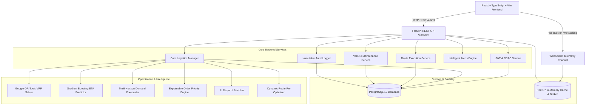

# System Architecture & Technical Design

## 1. High-Level Architecture Overview

The **Smart Logistics & Route Optimization Platform** is an enterprise-grade, cloud-native logistics dispatch, vehicle routing, telemetry tracking, and decision-support system.

---

## 2. Component Breakdown

### A. Frontend Layer (Single Page Application)
- **Framework**: React 18 with TypeScript and Vite.
- **Styling**: TailwindCSS with responsive, accessible, dark/light theme elements.
- **State & Context**: `AuthContext` for JWT tokens and role state management.
- **Real-Time Telemetry**: Custom WebSocket client with auto-reconnection and buffer replay.
- **Visuals & Charts**: Leaflet interactive route maps, Lucide icons, and responsive analytical charts.

### B. API Gateway & Application Server
- **Framework**: FastAPI (Python 3.11/3.13) with asynchronous ASGI architecture.
- **Security Middleware**: CORS origin verification, Content Security Policy, X-Frame-Options, X-Content-Type-Options, HSTS.
- **Observability Middleware**: `X-Request-ID` correlation propagation, latency measurement in ms, and global error sanitization.
- **Rate Limiting**: Sliding-window Redis-backed throttler with in-memory fallback.

### C. Deterministic Route Optimization (Google OR-Tools)
- **Solver**: Vehicle Routing Problem with Time Windows (VRPTW) and Capacity Constraints (CVRP).
- **Matrix Calculations**: Great-Circle / Haversine distance and transit time matrices.
- **Constraints Enforced**:
  - Vehicle payload capacity (kg).
  - Stop delivery time windows (seconds).
  - Maximum allowable route transit distance (km).
  - Maximum allowable driving hours per shift.
  - Driver & vehicle assignment compatibility.

### D. Machine Learning & Predictive Engines
- **AI ETA Prediction**: Scikit-Learn Gradient Boosting Regressor taking distance, waypoint density, speed, weather factor, and hour of day.
- **Demand Forecasting**: Multi-horizon autoregressive forecasting (1, 7, 14, 30 days) with confidence intervals and peak load analysis.
- **Delivery Delay Risk**: Multi-variable classification model evaluating traffic indices, weather severity, and deadline margins.
- **Order Priority Scoring**: 0–100 heuristic scoring classifying into Critical, High, Medium, and Low tiers.

### E. Data Persistence & Caching
- **Primary Relational Store**: PostgreSQL 16 managed with SQLAlchemy 2.0 `AsyncSession` and Alembic migrations (`001_create_users_table` through `008_create_delivery_points_table`). Pure PostgreSQL persistence across all domain models with zero dependence on in-memory stores.
- **Caching & Message Broker**: Redis 7 for real-time driver GPS coordinates, rate limiting counters, and session token blacklisting.
- **Idempotent Data Seeding**: Standalone CLI seeder (`scripts/seed_demo_data.py`) and development bootstrap (`seed_demo_data`) providing reproducible NYC demo warehouses, customers, drivers, vehicles, orders, and initial routes.

---

## 3. Data Flow & Lifecycles

### Dispatch Optimization Flow:
1. Dispatcher selects active orders and available fleet vehicles.
2. FastAPI triggers `RouteOptimizer.optimize_dispatch()` calling `VRPSolver`.
3. OR-Tools solver runs first-solution heuristic with guided local search meta-heuristics.
4. Optimized routes and ordered route stops are saved to PostgreSQL.
5. Notification alerts are broadcast via WebSockets to assigned drivers.

### Driver Route Execution & Tracking Flow:
1. Driver logs in and opens `/driver/routes/:id`.
2. Driver clicks "Start Route" $\rightarrow$ Route status transitions to `IN_PROGRESS`.
3. Geolocation telemetry streams via WebSocket `/ws/tracking` every 5 seconds.
4. Telemetry broker updates driver coordinates in Redis and evaluates proximity to next stop.
5. Upon arrival and signature verification, stop transitions to `COMPLETED` and order to `DELIVERED`.
6. Audit logger records immutable timestamped operational proof.
